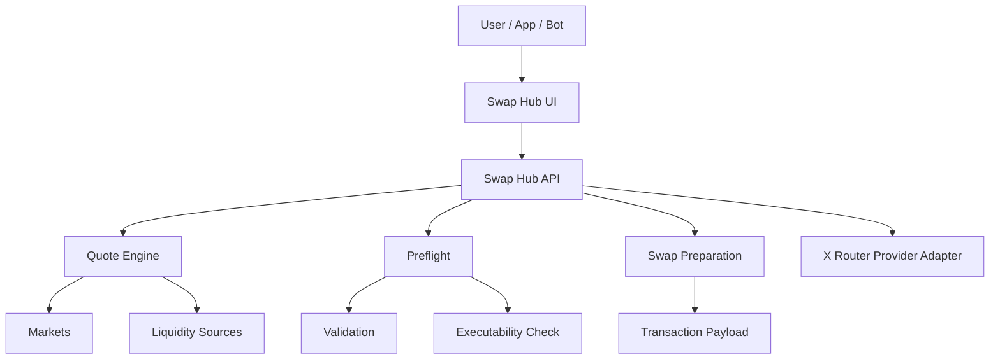
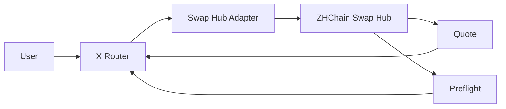

# ZHChain Swap Hub

**On-chain swap and liquidity infrastructure for ZHChain.**

ZHChain Swap Hub is an experimental swap infrastructure project designed to provide quote discovery, liquidity-aware routing and transaction preparation for assets on ZHChain.

The project is being developed as an independent swap layer that can also act as a liquidity and execution provider for **X Router**.

---

## 🚀 Goals

ZHChain Swap Hub aims to provide:

- on-chain swap discovery
- liquidity-aware quoting
- route comparison
- transaction preparation
- preflight validation
- independent pricing logic
- provider integration for external routers
- future execution support

---

## 🧭 Architecture



ZHChain Swap Hub is designed to remain usable as a standalone swap service while also exposing quote and execution capabilities to external routing systems.

---

## ⚙️ Current Status

**Stage:** Active MVP development

Current work includes:

- Cloudflare Worker backend
- D1 persistence
- live market discovery
- BigInteger quote engine
- `/api/quote`
- `/api/swap/prepare`
- `/api/swap/preflight`
- UI quote preview
- preflight validation
- transaction preparation flow

Signing and transaction broadcasting are intentionally not enabled yet.

---

## 🔌 API

Current API surface includes:

### Quote

```text
GET /api/quote
```

Used to request a swap quote.

### Swap Preparation

```text
POST /api/swap/prepare
```

Builds the data required for a potential swap transaction.

### Preflight

```text
POST /api/swap/preflight
```

Checks whether the requested operation can be executed under current conditions.

---

## 🧩 Role in X Router

ZHChain Swap Hub can operate as a provider for **X Router**.

Example flow:



The Router does not need to understand the internal implementation of the Swap Hub.

It only consumes normalized information such as:

- quote
- liquidity
- route
- limits
- fees
- executability
- reason for rejection

---

## 🌐 Design Principles

### Independent swap logic

The project is designed to avoid hard dependency on a single external pricing source.

### Honest executability

A quote should not automatically be treated as executable.

Execution readiness must be verified separately through preflight checks.

### Modular provider model

Swap Hub can serve:

- its own UI
- bots
- external applications
- X Router
- future automation systems

### BigInteger-safe calculations

Financial calculations are designed to avoid floating-point precision errors.

---

## 🛠 Tech Stack

`JavaScript` · `Cloudflare Workers` · `D1`  
`REST APIs` · `JSON-RPC` · `BigInteger arithmetic`

---

## 🗺 Roadmap

- [x] Cloudflare Worker backend
- [x] D1 integration
- [x] live market discovery
- [x] BigInteger quote engine
- [x] `/api/quote`
- [x] `/api/swap/prepare`
- [x] `/api/swap/preflight`
- [x] UI quote preview
- [ ] wallet signing flow
- [ ] transaction broadcasting
- [ ] execution receipts
- [ ] X Router adapter
- [ ] additional markets
- [ ] public developer documentation

---

## ⚠️ Development Status

ZHChain Swap Hub is currently experimental software.

Interfaces, market logic and transaction preparation may change as development continues.

Do not treat current quotes as production-ready financial execution guarantees.

---

## 🤝 Collaboration

Open to:

- Web3 infrastructure integrations
- routing integrations
- liquidity provider integrations
- grants
- accelerators
- developer tooling partnerships

---

## 📌 Maintainer

**Alexey Chistyakov**  
Independent builder focused on cross-chain infrastructure, routing and automation.
